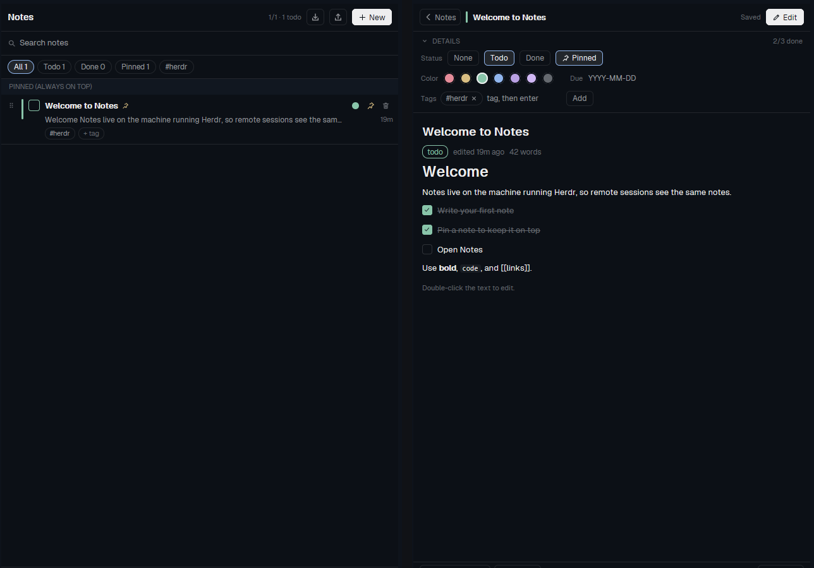

# Notes

A Notes panel for the Herdr app. A Notes button sits at the top right of the tab bar and opens a panel beside the work area: a list of notes, and a page for each note. Notes are stored once, on the machine running Herdr, so spaces on remote machines use the same notes and nothing is installed there.



## What you see

- **Button:** "Notes" with a 14px document icon, 26px high, in the tab bar row. Selected background while the panel is open.
- **Panel:** a 440px column (min 340, max 900) beside the work area, hidden until toggled. Chrome background, 44px header with a border below.
- **List:** header "Notes" with a count ("1/1 · 1 todo"), Import and Export icon buttons and a primary New button. Below: a search field, filter chips (All, Todo, Done, Pinned, then one chip per tag), then the rows. Pinned notes are listed first under "PINNED (ALWAYS ON TOP)", then "OTHER NOTES".
- **Row:** a grip, a 3px color stripe, a todo box, the title (bold, struck through when done), a one-line preview, tag chips with "+ tag", then a color dot, pin and trash buttons and the age ("19m").
- **Note page:** header with Back, a color tick, the title, a save state ("Saved") and an Edit button. A collapsible DETAILS block with status (None, Todo, Done), Pin, seven color dots, a due date field and tags. Then the content, rendered as Markdown with clickable checkboxes. A footer with Copy markdown, Duplicate and Delete.
- **Edit mode:** a title field, a toolbar (H1, H2, H3, B, I, code, list, task, quote, block, [[ ]]) and a Markdown editor. The button reads Done.
- **Export and Import pages:** format and scope choices, a preview of the file, a path field, and Save file or Choose file.
- Herdr theme colors throughout. Note colors map to ansi1 to ansi5, ansi13 and dim, so they follow the theme.

## How it behaves

- Clicking a note opens it in preview. The Edit button, a double-click on the text, or creating a new note starts editing. Done or Esc returns to the preview, Esc again to the list.
- New creates a note and opens it in edit mode. Leaving an empty note deletes it.
- The todo box cycles none, todo, done. Pin moves a note to the top group. Dragging a row by its grip reorders it inside its group; dragging across the pinned boundary is refused with a message. Dragging is off while a search or filter is active.
- Delete asks on the row, then offers Undo for 7 seconds.
- **Paste:** with the panel focused and no text field focused (click a blank part of the panel), Ctrl+V on the list creates a note titled `Note #<count + 1>` on top, unpinned, with the clipboard text as content. On a note page it appends the text on a new line at the end of the content.
- Saves are immediate for list actions and 600ms after typing. Every save reads the file first and merges with what is there, newest edit per note wins and deletes win, so the Herdr terminal plugin or another window can edit at the same time. External changes appear within about 2.5 seconds.
- Export writes JSON (re-importable) or one Markdown file with every note after a `=== file: name ===` line, to a path you type. An existing file asks before it is replaced. Import reads a file, shows how many notes are new and how many already exist, and offers Skip duplicates, Import as new or Replace all, with Undo.

## Built from

- `mods/notes/`: `main.js` (the view, role `toggle` draws the tab-bar button), `core.js` (pure note logic, a copy of the terminal plugin's `src/core.mjs`), `mod.json` (`place: none`, focusable, four palette entries), 14 small SVG icons.
- `keys.json`: `alt-n` toggles the panel. Merge it into the person's keys; ask before replacing `alt-n`.
- Layout: add this node to the row that holds the work area, outside any stack, next to the Files/Changes panel:

  ```json
  { "id": "notes-panel", "type": "column", "size": { "px": 440 }, "min": 340, "max": 900, "hidden": true,
    "children": [{ "id": "notes", "type": "block", "content": { "mod": "notes" } }] }
  ```

  Then add the button. Either a block beside the tab bar in a row, `{ "id": "notes-toggle", "type": "block", "content": { "mod": "notes", "props": { "role": "toggle" } }, "size": { "px": 100 } }`, or, in a tab bar mod you own, a button whose click runs `run("layout.toggle", { id: "notes-panel" })`. Clone shipped layouts and mods first.
- Herdr APIs: `readTextFile`, `writeTextFile` (compare-and-swap writes), `pickFiles`, `home`, `theme`, `settings`, `layout`, `props`, `run`, `nextCommand`, `checking`; `cx.read_from_clipboard`, `cx.write_to_clipboard`; gpui-base `InputState`, `Input`, `EditorState`, `Editor`, `TextView.markdown`.
- Commands from `nextCommand()`: `notes.new`, `notes.paste`, `notes.open`, `notes.export`, `notes.import`, `notes.back`, `notes.focus`.
- Programs: none. Network: none. Files: reads and writes `~/.herdr-notes/notes.json`, and writes an export wherever the person types a path. Tell the person that before adding it.

## Watch out

- Never use the `cx` from `render` inside a click handler. Every handler takes its own `(event, cx)`; using the render one made clicks work only after typing in the search field.
- `writeTextFile(path, text, expected)` fails on a stale snapshot. Pass the text you last read (null for a new file) and, on failure, read again and merge.
- `InputState` and `EditorState` must be created in `init`, never in `render`. Their `change` event also fires for `set_value`; compare with the note's text before marking it dirty.
- The panel only counts a paste when `handle.is_focused()` is true for the root, which is when no text field has the keyboard. Buttons and chips call `handle.focus()` on mouse down so a click gives the panel the keyboard.
- `readTextFile` reads up to 1 MiB, so a larger notes file or import is refused.
- Keys: `cmd-v` is how the kit spells the platform Paste modifier on every OS. The mod also accepts `ctrl-v` and `shift-insert`.

## Done when

- `herdr-app check ~/.config/herdr-app/mods/notes` passes and `herdr-app status` shows no errors.
- The Notes button toggles the panel, and the open state survives switching spaces.
- A new note appears in the list and survives restarting the app. `~/.herdr-notes/notes.json` holds it.
- Pinning moves a note to the top group. Dragging reorders within a group.
- Clicking a note shows a preview; Edit or double-click edits; ticking a checkbox in the preview updates the note.
- Export then Import into an empty list restores the same notes. Import with Skip it adds nothing the second time.
- Pasting text on the list creates `Note #<n>` on top, unpinned; pasting on a note page appends a new line.
